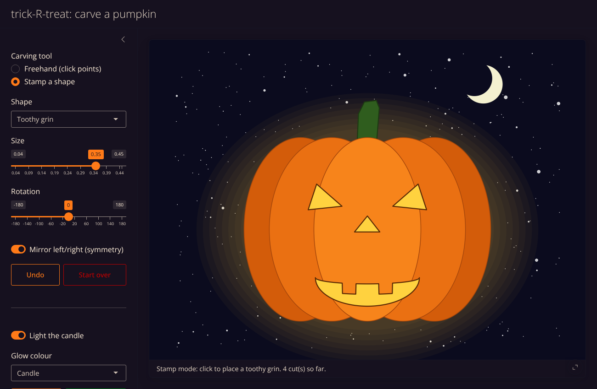

# trick-**R**-treat

## Pumpkin Carving with R by Jeff Wagner 
## October 20, 2020 
### Adapted from the BMSC Blog (https://bmscblog.wordpress.com/) 


Carve your very own digital pumpkin with R!



### Shiny app (recommended)

```r
install.packages(c("shiny", "bslib"))  # first time only
shiny::runApp()                        # from the project folder
```

* **Freehand:** click on the pumpkin to drop points. Close the shape by clicking the first point again, or by pressing **Enter**/**Finish shape**. Tick *Smooth curved edges* for rounder cuts.
* **Stamp a shape:** click to place ready-made triangles, circles, diamonds, stars, grins or toothy grins. Use the sliders to change size and rotation.
* **Mirror left/right:** carve one eye and the other appears automatically. Shapes placed on the centre line, like a nose, are not doubled.
* **Undo** (or Backspace) removes the last point or cut. **Esc** cancels the shape in progress. **Start over** clears everything.
* Light or snuff out the candle, pick a glow colour, roll a **New sky**, and **Save PNG** to keep your jack-o'-lantern.

### Classic script

`RpumpkinCarving.R` is the original version, which uses `locator()`. Change the number of points in each `locator()` call to make simpler or more complex carvings.

Have fun and stay spooky!
